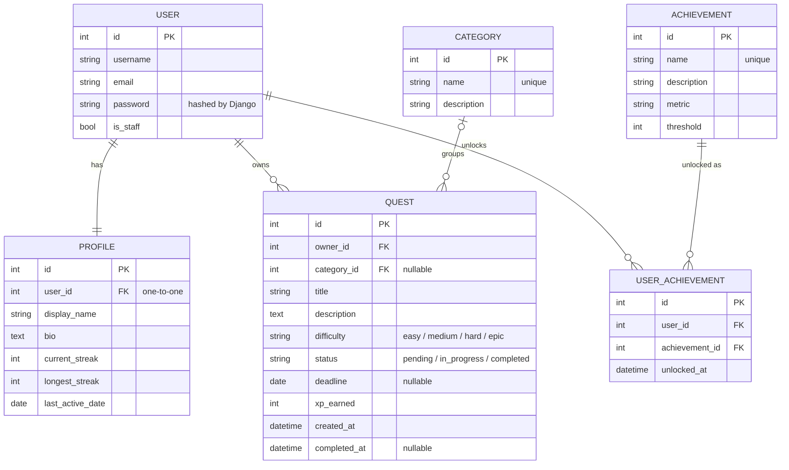

# Database design

[Back to README](../README.md)

The database is SQLite (`backend/db.sqlite3`). All tables are created from the models by
`python manage.py migrate`. `User` is Django's built-in user model from `django.contrib.auth`.

## ER diagram



## Tables

| App | Model | Table | Purpose |
| --- | --- | --- | --- |
| Django | `User` | `auth_user` | Login details |
| accounts | `Profile` | `accounts_profile` | Display name, bio and streak |
| quests | `Category` | `quests_category` | Shared list of categories |
| quests | `Quest` | `quests_quest` | Each user's quests |
| achievements | `Achievement` | `achievements_achievement` | The list of badges |
| achievements | `UserAchievement` | `achievements_userachievement` | Which user unlocked which badge, and when |

## Relationships

| Relationship | Field | Type | `on_delete` | Why |
| --- | --- | --- | --- | --- |
| User - Profile | `Profile.user` | One-to-one | `CASCADE` | Deleting a user deletes their profile |
| User - Quest | `Quest.owner` | Many-to-one (ForeignKey) | `CASCADE` | Deleting a user deletes their quests |
| Category - Quest | `Quest.category` | Many-to-one, optional | `SET_NULL` | Deleting a category keeps its quests, just without a category |
| User - Achievement | `UserAchievement` | Many-to-many through a model | `CASCADE` on both sides | The extra table stores `unlocked_at` |

The `related_name` on each foreign key lets us go backwards, for example `user.quests.all()`,
`user.profile` and `user.achievements.all()`.

## Rules kept by the database

- `Category.name` and `Achievement.name` are unique.
- `UserAchievement` has a `UniqueConstraint` on `(user, achievement)`, so a badge can only be
  unlocked once per user.
- `Profile.user` is one-to-one, so each user has exactly one profile.

## Values that are calculated, not stored

| Value | How it is worked out |
| --- | --- |
| Total XP | `Sum("xp_earned")` over the user's completed quests (`quests/utils.py`) |
| Level | `total_xp // 100 + 1` |
| Leaderboard rank | Position in a query ordered by total XP, completed count, username |
| Streak shown today | `Profile.streak_today` returns 0 if the last active day was before yesterday |

`xp_earned` is saved on the quest when it is completed, so if the difficulty is changed later
the XP already earned stays the same.

## Data migrations

Two migrations add starting data, so a fresh database is ready to use:

- `quests/migrations/0002_default_categories.py` adds Study, Work, Health, Fitness, Personal,
  Finance and Hobby.
- `achievements/migrations/0002_default_achievements.py` adds the 8 achievements.

## Some ORM queries used in the project

```python
# Filter + search (quests/views.py)
Quest.objects.filter(owner=request.user).filter(
    Q(title__icontains=query) | Q(description__icontains=query)
)

# Several counts in one query (quests/utils.py)
Quest.objects.filter(owner=user).aggregate(
    total=Count("id"),
    completed=Count("id", filter=Q(status="completed")),
)

# GROUP BY category (reports/views.py)
my_quests.values("category__name").annotate(total=Count("id"), xp=Sum("xp_earned"))

# XP per day: GROUP BY the date part of completed_at (reports/views.py)
my_quests.filter(status="completed").annotate(day=TruncDate("completed_at")) \
    .values("day").annotate(xp=Sum("xp_earned"))

# Leaderboard: annotate every user with totals from their quests (reports/views.py)
User.objects.annotate(
    total_xp=Sum("quests__xp_earned", filter=Q(quests__status="completed"), default=0),
    completed_count=Count("quests", filter=Q(quests__status="completed")),
).order_by("-total_xp", "-completed_count", "username")
```
